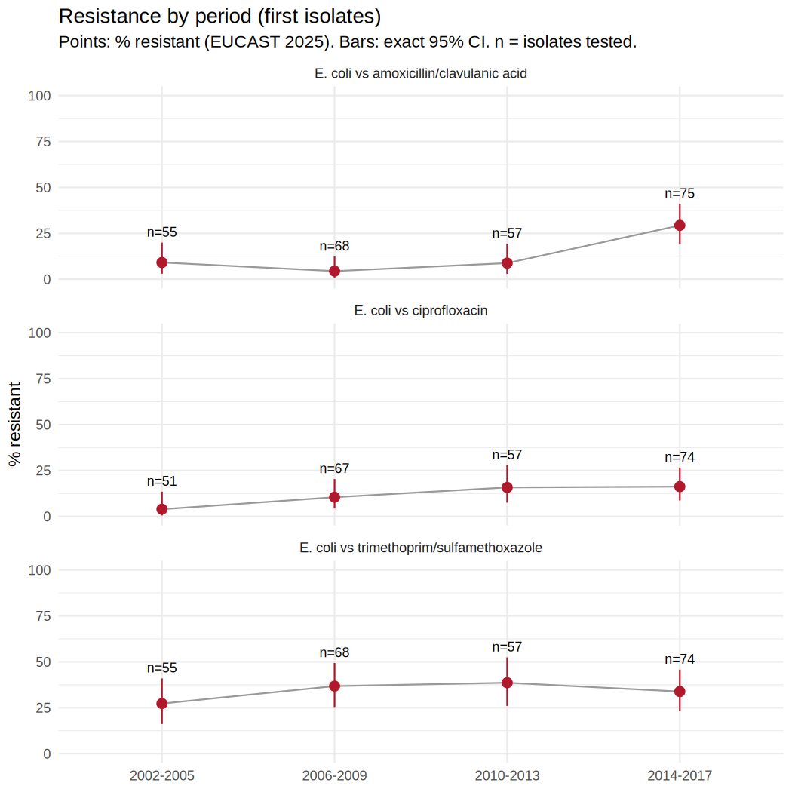
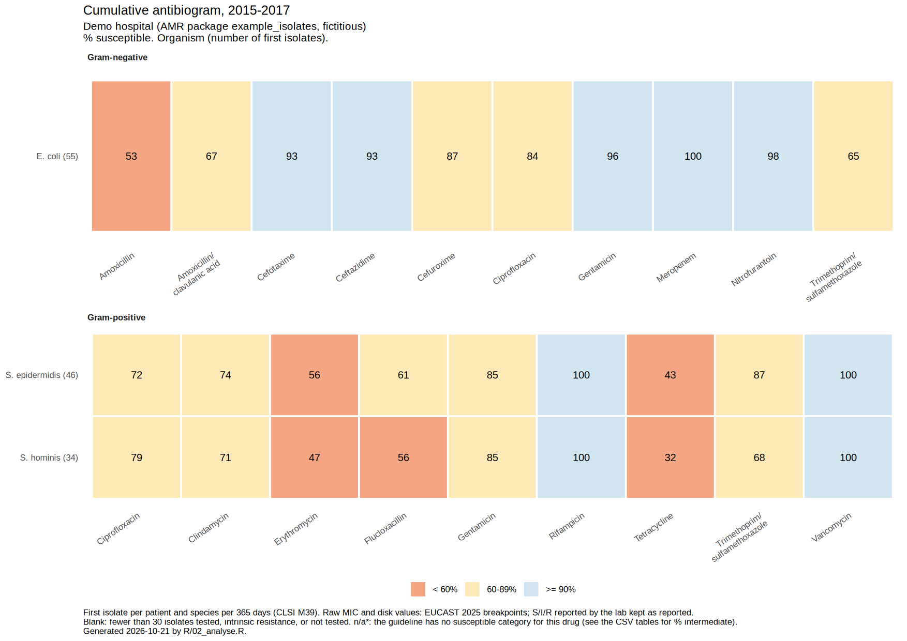

# AMR surveillance workflow in R

[](https://github.com/FerrumSL/amr-surveillance-r/actions/workflows/run-all.yml)

R scripts that take a lab export of antibiotic test results and turn it into the usual
surveillance outputs: a cleaned, pseudonymised dataset, a one-page printable antibiogram,
resistance over time with confidence intervals, an infection-control alert list (MRSA, VRE,
CRE, carbapenem-resistant *A. baumannii* and *P. aeruginosa*) and a short written summary.
The heavy lifting is done by the [AMR package](https://amr-for-r.org).

It reads exports with any column names (through a column map), WHONET exports (a ready
map is included), and S/I/R results or raw MIC and disk-zone values, which it interprets with
one stated EUCAST or CLSI version.

**Demo data.** The default run (`config/demo.R`) uses `example_isolates`, a dataset that
ships with the AMR package. It holds 2,000 made-up isolates from 2002 to 2017.
To give the cleaning step something to do, `R/00_fetch.R` messes it up on purpose: organism
names spelled several ways, results written as "s", "Resistant" or "SENSITIVE", and some dates
in dd/mm/yyyy. None of the numbers describe a real hospital or country. The demo is also the
only run with a hand-written interpretation: `R/03_report.R` checks each of its claims against
the numbers, and a test checks that cleaning recovers the original data exactly.

**Real data.** The same pipeline also runs on 2,138 real human isolates from
[NCBI BioSample](https://www.ncbi.nlm.nih.gov/biosample/) antibiograms (E. coli,
K. pneumoniae, S. aureus, P. aeruginosa, A. baumannii, E. faecium), with raw MIC and disk
values and the S/I/R each submitting lab reported. That lab call is used to check the
pipeline's interpretation (see below). These isolates were picked by their submitters, often
because they were resistant, so their resistance rates say nothing about any population.

## Results

- [`reports/summary.md`](reports/summary.md): the main numbers and what I read from them
- [`reports/cleaning_log.md`](reports/cleaning_log.md): what cleaning changed, and which
  organism names a person should double-check
- [`reports/antibiogram.pdf`](reports/antibiogram.pdf): the one-page antibiogram for clinicians
- `reports/tables/`: antibiograms, resistance by period, trend tests and `alerts.csv` as CSV
- [`reports/ncbi/`](reports/ncbi/): the same outputs for the real NCBI isolates, plus
  [`validation.md`](reports/ncbi/validation.md), the check against the labs' own calls




## How to run it

You need R (tested on 4.6.1). From the project folder:

```sh
Rscript -e 'renv::restore()'
Rscript R/run_all.R
```

This cleans the data, runs the analysis, writes the reports and then runs the tests.
`Rscript R/run_all.R config/ncbi.R` does the same for the real NCBI isolates.

### On your own lab's export

1. Copy `config/demo.R` to `config/my_lab.R`. Set `demo = FALSE`, `name`, `input`,
   `guideline`, the years, and new `processed` and `reports` paths so the demo outputs are not
   overwritten. The run stops if `demo = TRUE` is left on with another input.
2. If the column names differ from `date`, `patient`, `organism` (and optionally `age`,
   `gender`, `ward`, `specimen`), point `column_map` at a CSV with columns `lab_column` and
   `standard`. Set `standard` to `ignore` for columns to drop (names, comments). For WHONET
   exports use `config/column_map_whonet.csv`.
3. Antibiotic columns are found by name: a code (`CIP`), a WHONET column (`CIP_ND5` = CLSI
   disk, `CIP_EM` = EUCAST MIC) or the drug name (`Ciprofloxacin`). Every value is read with
   `guideline`. Disk zones from the other system's disks (`_ND` under EUCAST, `_ED` under
   CLSI) are not read, because the disk contents differ; the cleaning log counts them. A
   column of numbers without MIC or disk in its name stops the run; rename it in the column
   map (`CIP_EM`).
4. Run `Rscript R/run_all.R config/my_lab.R` and read `reports/cleaning_log.md` first.

Patient IDs are replaced with keyed hashes (HMAC-SHA256) before anything is saved. The key is
in `salt.txt`, created on the first run and kept out of git. Keep it: the same key gives the
same pseudonym on every run, which is what lets first isolates be counted across years, and
it lets the lab look a patient up again. Without it the IDs cannot be recovered by hashing
every possible hospital number. Columns not mapped to a standard name are never written out.

[`docs/WORKFLOW.md`](docs/WORKFLOW.md) walks through each step, why it's done that way, and
how to point the scripts at a different export.

## What's in here

```
config/demo.R          settings for the demo run (copy it for a new export)
config/ncbi.R          settings for the real NCBI isolates
config/column_map_*.csv  export column names -> standard names (WHONET, NCBI)
R/00_fetch.R           exports the example data and adds the deliberate mess
R/00_fetch_ncbi.R      downloads the NCBI antibiograms and builds a WHONET-style export
R/01_clean.R           column map, organism names, S/I/R and MIC/disk interpretation,
                       dates, duplicates, pseudonymisation, infection-control alerts
R/02_analyse.R         first isolates, antibiograms (CSV, PNG, PDF), resistance by period, trend test
R/03_report.R          writes summary.md; for the demo, checks its claims against the numbers
R/04_validate.R        compares the pipeline's MIC/disk interpretation with the labs' calls
R/run_all.R            runs all of the above, then the tests
data/raw/              the inputs (demo, NCBI snapshot)
data/organism_lookup.csv  manual fixes for names the AMR package matches wrongly
data/processed/        the cleaned, pseudonymised isolates
tests/testthat/        tests for the cleaning, interpretation, WHONET import and alerts
```

## A few things worth knowing

- Abbreviated names are a trap. `as.mo("S. hominis")` returns *Streptococcus* hominis, but a
  lab writing that almost always means *Staphylococcus* hominis. I found four of these and
  fixed them in `data/organism_lookup.csv`. The cleaning log lists every name that was matched
  approximately, so they can be checked by hand.
- The test suite cleans the messy file and checks that the result matches the package's
  original data exactly, value for value.
- Organisms that are naturally resistant to a drug (for example *K. pneumoniae* and
  amoxicillin) are left blank in the antibiograms, since that isn't acquired resistance.
- I used `example_isolates` rather than the package's `WHONET` example for the demo, because
  `WHONET` only has 500 isolates spread over two countries and 16 years, which is too few for
  trends. The tests use `WHONET` to check the WHONET import.

## What the real data showed

Running real exports through the pipeline found problems the demo data never had. Each one
is now handled, and most are covered by a test:

- **Guessed column names.** `as.ab()` matches loosely: it reads a `Country` column as
  metronidazole, `Ward` as prulifloxacin and `ESBL` as cefepime/enmetazobactam. Antibiotic
  columns are now matched exactly, and any other column must be mapped or ignored.
- **EUCAST disk zones under CLSI.** 277 zones in the NCBI data were measured with
  EUCAST disks. Reading them with CLSI breakpoints would be wrong (different disk content), so
  they are left out and counted. MICs are read with one guideline whatever the column says.
- **Combination MICs** such as `16/4` (piperacillin/tazobactam) and `0.5/9.5`
  (trimethoprim/sulfamethoxazole) are read by their first part. Values that are still not
  valid, for example `>=6.4/121.6`, are listed in the cleaning log rather than dropped quietly.
- **No breakpoint.** About 2,800 NCBI values have no CLSI 2025 breakpoint: veterinary drugs
  from food-safety panels, and the oxacillin disk for *S. aureus* (CLSI uses cefoxitin). They
  stay blank and are counted per column in the log; they are never read as susceptible.
- **Not interpretable (NI)** results were counted in the denominator of resistance by
  period. They are now left out.
- **Year-only dates.** 1,001 of 2,138 NCBI isolates have only a year. They are left out of the
  export because first-isolate rules need a date; the date parser still refuses to guess.
- **Intrinsic resistance in alerts.** *E. casseliflavus* is vancomycin resistant by nature
  (vanC) and was flagged as VRE. Alerts now ignore intrinsic resistance (EUCAST Expected
  Resistant Phenotypes), and CRE ignores imipenem alone for *Proteus*, *Providencia* and *Morganella*.
- **Colistin under CLSI** has no susceptible category since 2020, so the antibiogram showed
  "0% susceptible". It now prints n/a with a footnote.

[`reports/ncbi/validation.md`](reports/ncbi/validation.md) compares the pipeline's CLSI 2025
reading of about 15,000 real MIC and disk values with the labs' own calls: about 95% agree.
Using the CLSI version from each isolate's collection year (possible for 10,603 tests) halves
the rate of major errors (pipeline R, lab S), from 52 in 15,328 to 18 in 10,603, so many of them
come from breakpoint changes. The largest gap is *S. aureus* and clindamycin: 127 isolates the pipeline calls S were reported R by the lab.
That pattern fits inducible clindamycin resistance, which a MIC cannot show and a D-test can.
When an export has a D-test column (WHONET: `Inducible clindamycin resistance`), the cleaner
now sets clindamycin to R for positive tests. The NCBI data have no D-test, so the
*S. aureus* clindamycin figure in `reports/ncbi/` is too high.

## Licence and credits

The code is released under the GNU General Public License v2 (see [`LICENSE`](LICENSE)).

The demo data (`data/raw/isolates_messy.csv`, `data/processed/isolates_clean.csv`) is derived
from the `example_isolates` dataset in the AMR package, which is also GPL-2. Intrinsic resistance rules come from EUCAST Expected Resistant Phenotypes
v1.2 (2023), as bundled in the AMR package.

The NCBI isolates in `data/raw/ncbi_*.csv` come from NCBI BioSample antibiograms,
downloaded on 2026-10-21 by `R/00_fetch_ncbi.R`. NCBI places no restrictions on their use,
although individual submitters may; each isolate's accession is kept in the raw files.

If you use the AMR package, please cite it:

> Berends MS, Luz CF, Friedrich AW, Sinha BNM, Albers CJ, Glasner C (2022). AMR: An R Package
> for Working with Antimicrobial Resistance Data. *Journal of Statistical Software*, 104(3),
> 1-31. [doi:10.18637/jss.v104.i03](https://doi.org/10.18637/jss.v104.i03)
